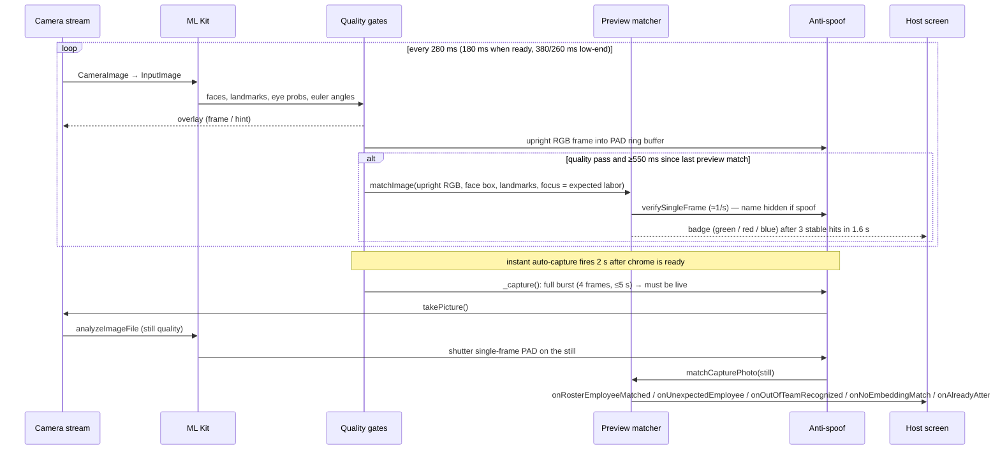
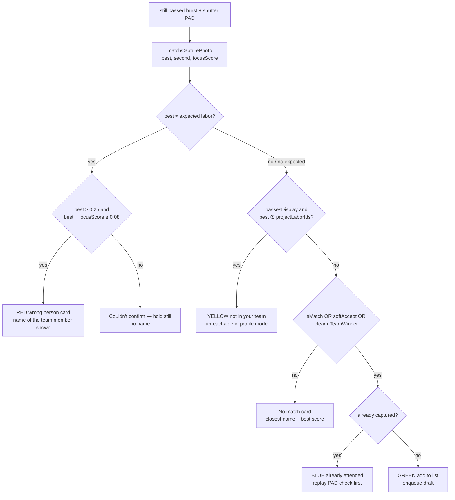

# Timesheet Face Capture — Technical Analysis and Architecture

Date: 2026-10-15  
Scope: the foreman "capture attendance" camera (Site Management / Timesheet), app side (Flutter) and backend side (Odoo 14 `elrace-addons`, AWS Lambda, S3).  
Purpose: a complete, fact-based description of what the feature does today, why a person who is **not** in the team is still identified as a team member, and the possible directions to fix it. Nothing in this document has been implemented; it is for review.

---

## 0. Executive summary

1. **Matching is on-device and closed-set.** The phone compares the live face only against the templates of the foreman's own labors ("Your Team"). The backend never sees the capture photo, never re-checks the match, and does not store a match score.
2. **Production mode is "profile photo mode"** (`PROFILE_PHOTO_MATCH=true` by default). One template per labor is built on the phone from the HR profile photo (`image_1920`). The multi-pose enrollment templates computed by Lambda are **ignored** in this mode.
3. **The stranger problem is structural, not a threshold problem.** A face that belongs to nobody in the roster still has a "closest" team member, and the code has no "unknown person" outcome in profile-photo mode. The three decision bars that exist today are:
   - green "add": score ≥ `minScore` (0.15) and lead over the second team member ≥ `minLead` (0.02) — now Odoo-configurable;
   - red "wrong person" on the labor camera: score ≥ **0.25** and lead over the *expected labor* ≥ **0.08** — **hard-coded, not affected by the Odoo parameters**;
   - yellow "not in your team": only reachable if the matched employee is outside `projectLaborEmployeeIds` — in profile-photo mode the roster *is* the project labor list, so **this path can never fire**.
4. **Two bypasses weaken the lead check after a still capture:** `clearInTeamWinner` (in-team best with score ≥ bar, no lead check) and `softAccept` (stream locked the same person).
5. **Score separation is small.** Pilot logs show genuine 0.39–0.54, impostor/stranger 0.30–0.44 against low-resolution templates (e.g. Kamal 1422: 120×129 px photo, 76 px face). With one template per person built from an HR thumbnail, a single cosine threshold cannot separate them reliably.
6. **Anti-spoof is independent of all of this** and is working as designed (MiniFASNet dual-model burst, 4 frames, any spoof frame blocks). Nothing in this document proposes changing it.

---

## 1. Architecture overview

### 1.1 Components

```mermaid
flowchart LR
  subgraph Phone["Flutter app (foreman phone / tablet)"]
    CAM[Camera stream\n720p]
    MLK[ML Kit Face Detection\nfast mode, landmarks, contours, classification]
    QG[Quality gates\nsize / pose / eyes / blur]
    PAD[Anti-spoof\nMiniFASNet v2 + v1SE, 80x80\nburst of 4 frames]
    PRE[Face preprocessor\n15% pad, eye alignment, 112x112\n(x-127.5)/128]
    EMB[MobileFaceNet TFLite\n512-d, L2 normalised]
    MAT[FaceMatcher\ncosine, best vs 2nd employee]
    PDB[(ProfilePhotoFaceDb\n1 template / labor\nprofile_photo_templates.json)]
    SDB[(SQLite face DB\nenrollment templates\nunused in profile mode)]
    HOST[FmTimesheetCaptureSubmitScreen\ncards, session, submit]
  end
  subgraph Odoo["Odoo 14 (elrace-addons)"]
    CFG[/GET /api/app/config/]
    LAB[/POST /api/timesheet/labor_list\nmy_hr_scope/]
    IMG[/GET /public/employee/image/id\nauth=public, raw image_1920/]
    FDB[/POST /api/face_db/version\nPOST /api/face_db/embeddings/]
    REG[/POST /api/register_face_images/]
    SUB[/POST /api/timesheet/submit\nhours only/]
    UFI[(user.face.image\n5 poses, 512-d, S3 key)]
    HRE[(hr.employee\nimage_1920, x_labor_ids,\nface_embedding_status)]
  end
  subgraph AWS
    S3[(S3 elrace-employee-face-images\nface-enrollment/emp/slug/pose.jpg)]
    LAM[Lambda face_embedding\nMobileFaceNet ONNX, Haar detector]
  end

  CAM --> MLK --> QG --> PRE --> EMB --> MAT --> HOST
  QG --> PAD --> HOST
  PDB --> MAT
  SDB -. PROFILE_PHOTO_MATCH=false .-> MAT
  IMG --> PDB
  LAB --> HOST
  CFG --> MAT
  HOST --> SUB
  REG --> S3 --> LAM --> UFI
  FDB --> SDB
  UFI --> FDB
  HRE --> IMG
  HRE --> LAB
```

### 1.2 Two template sources, one switch

| | Profile-photo mode (**production default**) | Enrollment mode |
|---|---|---|
| Flag | `PROFILE_PHOTO_MATCH` dart-define, default `true` (`profile_photo_face_db.dart` → `ProfilePhotoMatchTest.enabled`) | `--dart-define=PROFILE_PHOTO_MATCH=false` |
| Template source | HR `image_1920` downloaded from `/public/employee/image/{id}` and embedded **on the phone** | Lambda embeddings synced via `/api/face_db/embeddings` into SQLite `site_mgmt_face_db_v1` |
| Templates per person | **1** (`pose = 'profile_photo'`) | 4–5 poses (front/left/right/up/down) |
| Who is in the comparison set | Project labor ∩ foreman `x_labor_ids` ("Your Team"); whole project labor list if the login has no team | All company employees with ≥4 ready templates (`in_foreman_team` flag tells the app who is in the team) |
| Can produce "not in your team" (yellow) | **No** (set is the team) | Yes |
| Image quality control | None beyond "a face was detected" | Lambda quality check skipped in `profile_mode=true`; app enrollment has pose gates and duplicate check |

---

## 2. App side — detailed flow

Main file: `lib/ui/presentation/timesheet/foreman/attendance/timesheet_capture_camera_panel.dart` (`TimesheetCaptureCameraPanelState`).  
Host: `lib/ui/presentation/timesheet/foreman/fm_timesheet_capture_submit_screen.dart`.

### 2.1 Per-frame pipeline



### 2.2 ML Kit detector (`lib/core/timesheet/services/face_capture_service.dart`)

| Option | Value |
|---|---|
| `performanceMode` | `fast` |
| `enableLandmarks` / `enableContours` / `enableClassification` / `enableTracking` | all `true` |
| `minFaceSize` | 0.08 of the image |
| Resolution | `ResolutionPreset.high` (~1280×720), Android `yuv420` |
| Shared instance | one detector for the whole app (ref-counted) |
| Upright frames | `decodeCameraImageUpright` rotates by `sensorOrientation` so ML Kit boxes line up with the RGB buffer given to PAD and the embedder |

### 2.3 Quality gates (`_evaluateQuality`)

| Gate | Still / shutter | Live stream |
|---|---|---|
| Min face width | 80 px absolute | `max(48 px, 6.2 % of frame width)` |
| Max face width | — | > 55 % of the short side → "Move back a little" (`AntispoofConfig.maxFaceWidthFraction`; also enforced on every burst frame) |
| Yaw / roll | ≤ 20° | ≤ 28° |
| Pitch | not checked | not checked |
| Eyes open | ≥ 0.35 | ≥ 0.28 |
| Sharpness (Laplacian variance) | ≥ 18 | not checked |
| Brightness, centering, oval | not enforced | not enforced (text hint only) |

Observation: a face at 6.2 % of 1280 px = **≈80 px wide** passes the stream gate. A 112×112 chip from an 80 px face is upscaled; embeddings from such chips are noisy and drift toward "average" templates (exactly the low-res HR thumbnails).

### 2.4 Preprocessing and embedding

| Step | Value | File |
|---|---|---|
| Crop pad | 15 % of max(w, h) (`lambdaPadFraction`) | `face_preprocessor.dart` |
| Alignment | rotate so eyes are horizontal (`useLandmarkAlignment = true`) | same |
| Resize | 112×112 RGB | same |
| Normalisation | `(pixel − 127.5) / 128` | `FaceRecognitionPreprocess` |
| Model | `assets/mobilefacenet_512.tflite` (converted from InsightFace `w600k_mbf.onnx`, SHA `9cc6e4a7…`) | `face_embedder.dart` |
| Output | 512-d, L2-normalised | same |
| Delegate | CPU (XNNPACK not enabled) | `tflite_interpreter_factory.dart` |
| Typical timings (logs) | preprocess 3–60 ms, embed 10–75 ms, match <3 ms | pilot log |

### 2.5 Matching (`domain/face_matcher.dart`, `data/models/face_match_result.dart`)

```
probe = L2(embedding)
for each template row: score = probe · L2(row.embedding)
perEmployee[id] = max score across that employee's templates
rank employees by score
best, second = top two *different* employees
margin = best − second
isMatch = best ≥ minScore AND (only one employee OR margin ≥ minLead)
passesDisplayThreshold = best ≥ minScore AND (second ≤ 0 OR margin ≥ minLead)
focusScore = best template score of the expected labor (if the camera was opened for one)
```

### 2.6 Thresholds in force today

| Constant | Value | Where | Odoo-configurable |
|---|---|---|---|
| `FaceMatchTuning.minScore` | **0.15** default | `face_recognition_config.dart`; `/api/app/config` → `face_match_min_score`; valid 0.10–0.90 | **Yes** (`elrace.face_match_min_score`) |
| `FaceMatchTuning.minLead` | **0.02** default | same; `face_match_min_lead`; valid 0–0.30 | **Yes** (`elrace.face_match_min_lead`) |
| `pilotThreshold`, `pilotSoftCaptureThreshold`, `pilotAutoCaptureMinScore`, `pilotDisplayThreshold` | = `minScore` | `FaceRecognitionMatch` | via minScore |
| `minWinnerMargin`, `minDisplayWinnerMargin` | = `minLead` | `FaceRecognitionMatch` | via minLead |
| `FaceExpectedLaborMatch.mismatchMinScore` | **0.25** | `face_recognition_config.dart` | **No** |
| `FaceExpectedLaborMatch.mismatchMinLead` | **0.08** (lead over the expected labor's own score, not over 2nd best) | same | **No** |
| `closeSecondDelta` | 0.05 (snackbar hint only) | same | No |
| `defaultThreshold` / `idealThreshold` | 0.75 / 0.80 — **unused** while `usePilotThresholdForMatch = true` | same | No |
| `verificationMinCosine` | 0.95 (E.3 debug only) | same | No |
| `FaceEnrollmentChecks` | same person ≥ 0.30; duplicate warn 0.52 / block 0.65 (enrollment only) | same | No |
| Profile photo quality log | low-res face < 90 px; look-alike ≥ 0.45 | `profile_photo_face_db.dart` | No |

### 2.7 Decision tree after a still capture (`_capture`, ~lines 1830–1980)



Where:

- `isMatch` = score ≥ minScore **and** lead ≥ minLead.
- `softAccept` = live preview had already locked the same employee, score ≥ minScore, passesDisplay.
- `clearInTeamWinner` = best is in the project labor list, score ≥ minScore, passesDisplay. Since the labor list is the whole roster in profile mode, this is "score ≥ minScore and passesDisplay" — the lead is checked only through `passesDisplayThreshold`, which uses `minDisplayWinnerMargin` (= minLead). So the lead check holds, but only the *display* variant; nothing requires a stronger lead for acceptance than for showing a name.

### 2.8 Live preview matching

| Item | Value |
|---|---|
| Interval | 550 ms (900 ms once an identity is locked; 800/1100 ms low-end) |
| Suppress after a miss | 900 ms |
| Stable identity | 3 hits of the same employee within 1.6 s |
| Preview PAD | one MiniFASNet frame about once a second; name hidden on spoof; low-end devices never show a name before capture |
| Badge rule | `passesDisplayThreshold` (score ≥ minScore, lead ≥ minLead) |
| Red on labor camera | `_judgeUnexpected`: score ≥ 0.25 and lead over expected ≥ 0.08; otherwise "unsure" (badge cleared) |
| Auto-capture | host uses `instantAutoCapture: true`: a capture fires 2 s after the shutter chrome becomes ready, independent of identity; re-arms when the face is lost or quality drops; paused while a red/blue card is held (new) |

### 2.9 Host screen roster and callbacks

| Step | Source |
|---|---|
| Project labor | `fetchLaborEmployeesForReport(projectId, includeDrivers: true)` → `POST /api/timesheet/labor_list`; `_projectLaborEmployeeIds` = their ids |
| Your Team | `timesheetForemanLaborsProvider` (`/api/timesheet/my_hr_scope`, `x_labor_ids`) → `ProfilePhotoFaceDb.setLabour(yourTeamOnly(projectLabor, team))` |
| Template build | background queue, 4 parallel downloads, 15 s timeout, cache 7 days, failed retry 1 day, pipeline version `mobilefacenet512-profile-v2` |
| Photo preparation | resize long side ≤ 800 / short side ≥ 480, 15 % white margin, JPEG q95, relaxed ML Kit detection, same preprocessor + embedder as the camera |
| Callbacks | `onRosterEmployeeMatched` → green card, session entry (`matchScore` kept locally), Hive queue; `onUnexpectedEmployee` → red held card; `onAlreadyAttended` → blue held card; `onNoEmbeddingMatch` → no-match notice; `onOutOfTeamRecognized` → yellow (dead in profile mode) |
| Submit | `POST /api/timesheet/submit` (`/v2`): employee ids, date, start/end, break, `coords {empId: {x_lat, x_long}}`. **No photo, no score, no liveness result is sent.** |

### 2.10 Anti-spoof (unchanged, for completeness)

| Item | Value |
|---|---|
| Models | `minifasnet_v2_2.7_80x80.tflite` (crop 2.7×), `minifasnet_v1se_4.0_80x80.tflite` (crop 4.0×), softmax averaged |
| Classes | 0 print, 1 live, 2 replay |
| Live frame | argmax live, live ≥ 0.70 (uncertain ≥ 0.45), print + replay < **0.10** |
| Burst | 4 frames (ring 350 ms, low-end 900 ms), budget 5 s, capture TTL 3 s |
| Soft spoof tolerance | **0** — any spoof frame blocks |
| Temporal | frozen boxes (IoU > 0.995) with head-motion variance < 0.05 and eye variance < 0.008 → fail |
| Face too large | > 55 % of frame width refused on live check and on every burst frame |
| AWS Face Liveness | compiled, `useAwsFaceLiveness = false` |
| Where it runs | full burst before `takePicture`, one more single-frame check on the still, one single-frame check ≈1/s on the preview to gate the name badge |

### 2.11 Logging

All face-match diagnostics are **local only**: `debugPrint` lines (`FaceRecognition:`, `ProfilePhotoMatch:`, `ProfilePhotoQuality:`, `AntiSpoof L1:`, `BurstVerification:`), `FacePilotLogStore` ring buffer (100) and `face_match_pilot_log.jsonl` in debug builds. No upload to Odoo exists.

---

## 3. Backend side — detailed

Repo `/Users/mjawad/projects/elrace/odoo14-clients`, branch `elrace-addons`. Modules: `emp_mobile_conf` (0.6.14), `elrace_backend_apis`, `elrace_employee_profile_fix`.

### 3.1 Data model

| Model / field | Purpose |
|---|---|
| `hr.employee.image_1920` | HR profile photo; the **only** input to production matching today, served raw by `GET /public/employee/image/<id>` (`auth='public'`, no resize, no auth) |
| `hr.employee.x_labor_ids` (M2M `foreman_labor_rel`) | foreman's team; drives "Your Team" and `in_foreman_team` |
| `hr.employee.face_embedding*`, `has_face_data`, `face_enrollment_status`, `face_enrollment_ready_count`, `face_enrollment_foreman_id` | enrollment summary; `ready` when ≥4 templates ready; primary embedding copied from the front pose |
| `user.face.image` | one row per pose (`front/left/right/up/down`), `s3_key`, `s3_url`, `face_embedding` (2048 bytes), `face_embedding_status`, retry count (cron stops at 3); unique `(emp_id, pose)` |
| `face.db.version` / `face.db.cache` | monotonically bumped version + cached JSON per `face_db:v{version}:foreman:{id}` |

### 3.2 Endpoints relevant to the camera

| Route | Auth | Used by the app for |
|---|---|---|
| `GET /api/app/config` | none | `isTestMode`, `splash_video_url`, **`face_match_min_score`**, **`face_match_min_lead`** (float or `null`), notices |
| `POST /api/timesheet/labor_list` | Bearer | project labor cards (`image_url`, `has_profile_image`, `face_embedding_status`) |
| `POST /api/timesheet/my_hr_scope` | Bearer | `x_labor_ids` cards → Your Team |
| `GET /public/employee/image/<id>` | public | profile photo for template building |
| `POST /api/face_db/version`, `POST /api/face_db/embeddings` | Bearer, foreman/HR gate | enrollment templates (unused in profile mode); full download, no delta; 5 s version TTL |
| `POST /api/register_face_images` | none (`csrf=False`) | multipart 4–5 poses → S3 → `user.face.image` pending → Lambda |
| `POST /api/face_embedding/callback`, `GET /api/face_embedding/{employee_image,template_image}/<id>` | `X-Face-Callback-Token` | Lambda writes embeddings back |
| `POST /api/timesheet/submit` (`/v2`) | Bearer | creates `account.analytic.line` — **no face data accepted or verified** |
| `POST /api/timesheet/submit_policy` | Bearer | geofence radius only |

### 3.3 Server-side embedding pipeline (Lambda `emp_mobile_conf/lambda/face_embedding/`)

| Step | Value |
|---|---|
| Detector | OpenCV Haar `haarcascade_frontalface_default.xml` |
| Pad | 15 % of max(w, h) |
| Input | 112×112 RGB, NCHW, `(x − 127.5) / 128` |
| Model | InsightFace `w600k_mbf.onnx` (`mobilefacenet-v1`), from S3 `face/mobilefacenet.onnx` |
| Output | 512-d, L2-normalised, `embedding_b64` |
| `profile_mode=true` (enrollment, HR photo) | takes the largest face, **skips** quality gates |
| `profile_mode=false` | fails on `multiple_faces`, `face_too_small` (< 50 px), `face_not_frontal` (> 35°), `low_quality` (sharpness < 60) |
| Crons | pending employee embeddings daily (batch 50); pending templates every 15 min (limit 100) |
| HR-photo auto embedding | ICP `face_embedding.sync_from_hr_photo` default **false** |

Note: the app's ML Kit + landmark alignment and Lambda's Haar + box crop are different front-ends to the same model. TC-C2 verified cosine > 0.95 for the *same crop*; it did not measure the effect of the different detectors/alignment on cross-source scores.

### 3.4 Documented test bars vs what the app uses

| Test (`emp_mobile_conf/scripts`) | Bar |
|---|---|
| TC-B1 determinism | ≥ 0.99 |
| TC-B2 cross photo, TC-C3 end-to-end | > 0.75 (ideal 0.80) |
| TC-B4 impostor | max cosine < 0.50 hard, < 0.75 attendance gate |
| TC-C2 / `verify_tflite_model.py` cross model | > 0.95 |
| `MODEL_CONVERSION.md` recommended mobile match | 0.65–0.72 |
| **App today** | **0.15 / lead 0.02** (pilot), 0.35 / 0.06 under test |

The backend tests were written for the **enrollment** pipeline (controlled 4-pose selfies on the same phone). The production app runs the **profile photo** pipeline, whose genuine scores (0.39–0.54 in logs) sit below every documented bar, which is why the bar was lowered to 0.15 in the pilot.

---

## 4. Why a stranger is identified as a team member

### 4.1 Observed data (pilot logs)

| Case | best | second | lead | Result |
|---|---|---|---|---|
| Genuine, good photo (Kyaw 4224) | 0.45–0.54 | 0.36–0.44 | 0.09–0.13 | green |
| Genuine, same person, weaker frame | 0.34–0.37 | 0.28–0.31 | 0.03–0.09 | green |
| Genuine but ambiguous frame | 0.44 | 0.43 | 0.01 | no match (lead) |
| Strangers (25-labor roster) | 0.08–0.20 | 0.05–0.19 | 0.00–0.13 | mostly no match at 0.15, but several `match=true` at 0.16–0.20 |
| Kamal 1422 template vs other templates | closest other employee 0.39–0.40 | | | flagged `LOW_RES` (76 px face) |

### 4.2 Root causes, in order of weight

1. **Closed set with no reject class.** `FaceMatcher` always returns a best employee. The only rejection is the pair (score, lead). There is no model of "what a non-member looks like", no per-person calibration and no second opinion.
2. **One low-quality template per person.** HR photos are 120–200 px thumbnails, sometimes tightly cropped PNGs; the app upscales them to ≥480 px and embeds. Low-res templates become "hub" vectors that score 0.3–0.4 against *everyone*, so they win for strangers and for far-away faces.
3. **Probe quality is not gated for matching.** A face 80 px wide passes the stream gate and is matched. Small, blurred or off-angle probes also drift toward the hub templates.
4. **The red card uses its own hard-coded bars.** On the labor camera the red "wrong person" verdict is `best ≥ 0.25 && best − focusScore ≥ 0.08`. Raising `elrace.face_match_min_score` to 0.35 does not touch it; a stranger scoring 0.30 against Kamal while the expected labor scores 0.10 is still shown as "Kamal".
5. **Lead is measured against the wrong reference.** On the labor camera the lead is "best − expected"; a stranger trivially beats an absent expected labor. On the project camera the lead is "best − second"; a stranger's two nearest hubs can differ by 0.05–0.13 by chance.
6. **Score scale mismatch with the documentation.** Every documented bar (0.65–0.80) assumes multi-pose enrollment selfies; the production path never produces such scores, so the operational bar was pushed to the impostor zone.

### 4.3 What the new Odoo parameters can and cannot do

| Setting | Effect |
|---|---|
| `minScore` 0.35, `minLead` 0.06 | Fewer strangers pass the **green** path; genuine users with weak photos (0.34–0.37) will start to get "No match"; the **red** card is unaffected. |
| Any value | Cannot create an "unknown person" outcome; cannot repair hub templates; cannot stop a 0.39 stranger-vs-Kamal hit. |

---

## 5. Enhancement directions (for discussion — not implemented)

Each option lists what changes, the expected effect on strangers (FAR) and on genuine users (FRR), and the work involved. They can be combined.

### Option 1 — Open-set reject using a background gallery (app only)

Add a set of **negative templates** that are never accepted: embeddings of other company employees (not in the team) and/or a fixed synthetic "generic face" set. A probe is accepted only if its best team score beats the best negative score by a lead. A stranger who is not in the team but is in the company will then match the negative gallery and be shown as **"Not in your team"** (the yellow path becomes live again).

- Source of negatives: `/api/face_db/embeddings` already returns all enrolled employees with `in_foreman_team=false`; for profile mode the app can also build profile-photo templates for the whole project labor list and treat non-team ones as negatives.
- Effect: strongest single fix for the "stranger from another team" case; neutral on outside visitors (not in HR at all).
- Work: app matcher + roster builder; no API change if `labor_list` is already the superset.

### Option 2 — Separate, Odoo-configurable bars for the red card and for acceptance

Move `FaceExpectedLaborMatch.mismatchMinScore / mismatchMinLead` to `/api/app/config` (`elrace.face_mismatch_min_score`, `elrace.face_mismatch_min_lead`) and make the red card additionally require `best ≥ minScore` and `best − second ≥ minLead`. Remove `clearInTeamWinner`/`softAccept` or make them respect a stricter "accept lead" (`elrace.face_accept_min_lead`).

- Effect: the knobs you set will actually control what you see; low cost.
- Work: small, app + 2–3 lines in `get_app_config`.

### Option 3 — Probe quality gate for matching

Require a minimum face width for *matching* (not just detection), e.g. ≥ 140 px in the still and ≥ 10–12 % of frame width on the stream, plus sharpness on the still before embedding. Show "Come closer" instead of matching a far face.

- Effect: removes most far-away false hits; slight slowdown for the foreman (one step closer).
- Work: app only; constants could also come from `/api/app/config`.

### Option 4 — Fix the template side (data quality)

a. Serve a **face-crop, min 400 px** image for matching from Odoo (new field or new route `/api/employee/face_image/<id>` with resize and a quality flag) instead of the raw `image_1920` thumbnail.  
b. Odoo report of labors with `LOW_RES` / `noFace` / `LOOK_ALIKE` photos (the app already computes this; moving it server-side with the Lambda pipeline makes it HR-visible).  
c. **Exclude** low-res templates from matching (mark `ProfileTemplateState.failed` with reason "photo too small") so hub templates cannot win; those labors fall back to manual pick until HR replaces the photo.

- Effect: attacks root cause 2; (c) is immediate and cheap.
- Work: (a) backend route + app; (b) backend; (c) app only.

### Option 5 — Multi-template per person (enrollment + profile)

Use the Lambda enrollment templates **and** the profile-photo template together (max over all), and switch `PROFILE_PHOTO_MATCH` to a per-employee fallback: enrollment templates when `face_enrollment_status = ready`, profile photo otherwise. Genuine scores for enrolled labors move to the 0.6–0.8 range the backend tests were designed for, allowing a per-employee bar (higher for enrolled, lower for profile-only).

- Effect: large FAR/FRR improvement for enrolled labors; requires foremen to enrol labors (flow already exists: `register_face_images`, 4 poses, S3, Lambda, push notification).
- Work: app roster merge + per-employee thresholds; no new API.

### Option 6 — Score calibration per template (z-score / cohort normalisation)

Instead of raw cosine, compare each probe to a template using `(score − μ_t) / σ_t` where μ/σ are that template's scores against all other templates in the roster (already computed for the quality log). Hub templates get a high μ and therefore need a much higher raw score to win.

- Effect: directly neutralises the Kamal-type hub without removing anyone; cheap.
- Work: app matcher only.

### Option 7 — Server-side second opinion on the capture (optional, later)

Upload the accepted still (or its 512-d embedding) with the timesheet entry; Odoo stores it on the `account.analytic.line` and a Lambda re-check (profile_mode=false, full quality gates) flags low-confidence entries for HR review. Does not block the foreman; gives an audit trail that does not exist today.

- Effect: accountability and data to tune thresholds; no live FAR change.
- Work: new/changed API (needs your approval as per live-API rule), storage, Lambda call.

### 5.1 Suggested combination

A realistic first step that does not touch anti-spoof and does not require re-enrolment: **Options 2 + 3 + 4c + 6**, then **Option 1** for cross-team strangers, then **Option 5** progressively as labors are enrolled. Option 7 can run in parallel on the backend.

---

## 6. File index

### App

| Area | File |
|---|---|
| Camera panel (stream, gates, PAD, capture, decisions) | `lib/ui/presentation/timesheet/foreman/attendance/timesheet_capture_camera_panel.dart` |
| Host screen (roster, cards, session, submit) | `lib/ui/presentation/timesheet/foreman/fm_timesheet_capture_submit_screen.dart` |
| Notice cards (green/blue/red, Try again / Next labor) | `lib/ui/presentation/timesheet/widgets/face_recognition/tm_face_capture_notice_tile.dart` |
| ML Kit facade, quality gates, upright decode | `lib/core/timesheet/services/face_capture_service.dart` |
| Thresholds | `lib/core/site_management/face_recognition/face_recognition_config.dart` |
| Remote tuning | `lib/core/services/app_config_service.dart` |
| Matcher / result | `lib/core/site_management/face_recognition/domain/face_matcher.dart`, `data/models/face_match_result.dart` |
| Preprocess / embed | `lib/core/site_management/face_recognition/domain/face_preprocessor.dart`, `domain/face_embedder.dart` |
| Profile-photo templates | `lib/core/site_management/face_recognition/profile_photo_face_db.dart` |
| Enrollment templates (SQLite, API) | `lib/core/site_management/face_recognition/data/**` |
| Service facade | `lib/core/site_management/face_recognition/face_recognition_service.dart` |
| Anti-spoof | `lib/core/site_management/face_recognition/antispoof/**` |

### Backend

| Area | File |
|---|---|
| App config (match bars) | `elrace_backend_apis/controllers/auth_controller.py` → `get_app_config` |
| Labor list / team / submit | `elrace_backend_apis/controllers/timesheet_controller.py` |
| Public profile image | `pandora_project_timesheets_apis/controllers/task_report_apis.py` (`/public/employee/image/<id>`) — **do not modify this module** |
| Face DB sync | `elrace_backend_apis/controllers/face_db_controller.py`, `utils/face_db_serializer.py`, `emp_mobile_conf/models/face_db_version.py` |
| Enrollment | `elrace_backend_apis/controllers/misc_controller.py` (`register_face_images`), `emp_mobile_conf/models/face_recongition.py`, `hr_employee_face_embedding.py` |
| Lambda callback | `elrace_backend_apis/controllers/face_embedding_callback_controller.py` |
| Lambda / inline inference | `emp_mobile_conf/lambda/face_embedding/`, `emp_mobile_conf/face_inference/`, `services/face_lambda_client.py`, `services/face_s3_client.py` |
| Docs / tests | `emp_mobile_conf/README_FACE*.md`, `MODEL_CONVERSION.md`, `scripts/tc_*.py` |
