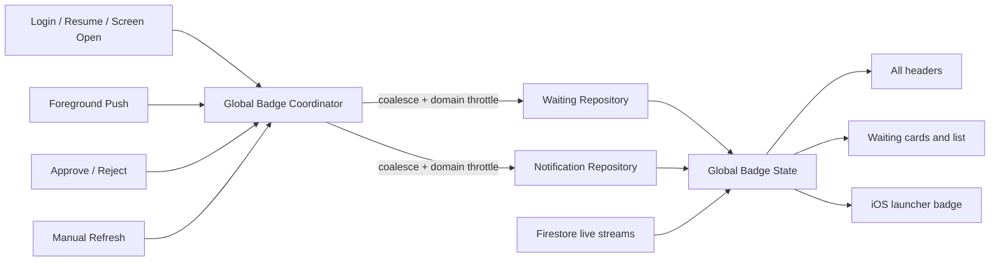

# HD-0149 - Counter and Badge Refresh Technical Audit

**Branch:** `hd-0149-counter-refresh-audit`

**Baseline:** `origin/main` at `2bb86fb`

**Audit date:** 2026-11-16

**Scope:** Static analysis of the Flutter, Android, iOS, Odoo API and Firebase paths. No application behavior was changed.

## 1. Scope and definitions

This report treats a **counter** as a user-visible numeric badge, queue total, unread total, or KPI. Dates, monetary values, timers, percentages, pagination indexes and non-numeric status chips are not counters. Repeated responsive renderings of the same logical value are listed once.

There are three materially different classes:

1. **Global actionable badges:** Waiting approvals, notification bell, chat unread and launcher icon badge.
2. **Home tile counters:** category summaries on the main home screen.
3. **Screen-local KPIs:** totals calculated or fetched only while a module screen is open.

The refresh defect reported in HD-0149 is primarily in class 1. Class 2 and class 3 are included because they can also become stale, but they should not all be put on one global refresh timer.

## 2. Executive findings

- The app has no single source of truth for global counters. Waiting, bell, chat and launcher badges are owned by separate singleton services and Firestore streams.
- Waiting count and Waiting records use the same Odoo endpoint and category rules, but execute independent requests and keep independent caches. A resume can refresh the number while leaving an already-open list stale.
- A Waiting count refresh downloads four complete approval lists only to count their lengths. Opening the Waiting screen downloads the same four lists again.
- The home notification header polls every **5 seconds** in legacy inbox mode and every **60 seconds** in v2 mode while mounted, in addition to resume, push and route-return refreshes.
- Approval-push refresh and home-return refresh share a 30-second throttle. A second approval event inside that window can leave the count stale until another trigger.
- Chat unread is live Firestore data, but each aggregate update can issue one message query per unmuted chat and each query is capped at 100 unread messages.
- The launcher numeric badge is implemented on iOS. The Android method-channel handler intentionally acknowledges `setBadge` without applying a numeric launcher badge; Android notification dots remain launcher/OEM behavior.
- Home widget API data has a five-minute cache and refreshes on initial home load or manual pull-to-refresh, not through the global resume coordinator.
- Some module KPIs are intentionally local or developmental. In particular, Pending Payslips is backed by mock data, not an API.

## 3. Counter inventory

### 3.1 Global actionable counters

| Counter | Screen / widget | Owner | Source | Exact refresh triggers | Evidence |
|---|---|---|---|---|---|
| Waiting total | Home headers and Waiting entry | `ApprovalCountService` | Four calls to `POST /api/my_approvals_grouped` for HR, RFQ, Invoice and Petty Cash, plus live Firestore Sign Document pending count | Header mount; authenticated app resume; home route return subject to 30 s throttle; foreground approval push subject to the same throttle; after approve/reject; Sign Document Firestore snapshot | `lib/core/services/approval_count_service.dart:106-145`; `lib/core/services/badge_refresh_service.dart:51-88`; `lib/core/services/timesheet_badge_watcher.dart:75-92`; `lib/firebase_service.dart:772-786` |
| Waiting category totals | Waiting sheet cards | `ApprovalsScreen` local `_countCache` | Lengths of category lists from `/api/my_approvals_grouped`; Sign Document uses its repository stream | Screen `initState`; category first open; pull-to-refresh; after approve/reject; explicit retry | `lib/ui/presentation/Email Approval/Approval.dart:87-98,356-494,591-613,1074-1075` |
| Notification bell - legacy | Home headers | `NotificationStorageService` | Server `/notifications` unread count minus the stored "last inbox open" baseline, protected by local FCM count | Header mount; 5 s polling; authenticated resume; foreground non-chat push; home return; local save/read/delete/clear; opening Notification Center acknowledges baseline and clears | `lib/core/services/notification_storage_service.dart:733-801,1058-1275`; `lib/ui/presentation/home_screen/widgets/home_glass_app_bar.dart:100-136`; `lib/ui/presentation/notification/notification_screen.dart:35-71` |
| Notification bell - v2 | Home headers and Notification Center | `NotificationInboxRepository` plus Firestore app-notification unread | `/v2/notifications/unread_count` plus `users/{uid}/app_notifications where read=false` | Header mount; 60 s polling; authenticated resume; `inbox.sync`/foreground push; live Firestore snapshots; mark-all-read/open center | `lib/core/notifications/notification_inbox_repository.dart:66-96`; `lib/core/services/timesheet_badge_watcher.dart:91-102`; `lib/firebase_service.dart:172-231` |
| Chat total unread | Home chat icon, bottom navigation and floating communications bar | `ChatUnreadBadgeService.count` | Firestore `userChats` stream, then message queries after `last_read_at` for every unmuted chat | Starts when a displaying widget calls `ensureListening`; live Firestore updates; stops/clears on logout. It is not refreshed by `ResumeCoordinator` | `lib/chat/services/chat_unread_badge_service.dart:13-59`; `lib/chat/repositories/chat_repository.dart:2041-2086` |
| Per-chat unread | Chat list rows | screen stream subscription | Firestore user-chat metadata and messages after `last_read_at` | Live while chat list row/subscription is mounted; changes when messages or read metadata change | `lib/chat/repositories/chat_repository.dart:2090-2137` |
| Sign Document pending | Waiting Sign Document card/header aggregate | `TimesheetBadgeWatcher` / `TimesheetApprovalRepository` | Firestore pending approvals for authenticated UID | Authenticated app start; every authenticated resume restarts watcher; Firebase auth change; live Firestore snapshot | `lib/core/services/timesheet_badge_watcher.dart:17-91`; `lib/core/timesheet/repositories/timesheet_approval_repository.dart:135` |
| My Actions - signature required | My Actions section | `SignatureActionsRepository` stream | Combined live Firestore chat-signable documents and personal `signature_documents` | Starts when section is mounted; Firebase auth switch; live document/chat updates | `lib/ui/presentation/home_screen/widgets/my_actions_section.dart:158-181`; `lib/ui/presentation/my_actions/data/repositories/signature_actions_repository.dart:31-72` |
| App icon badge | OS launcher | `AppIconBadgeService` | Local notification count plus Firestore app-notification unread | Any `NotificationStorageService` persist; resume badge refresh; Timesheet watcher snapshots; notification read/clear | `lib/core/services/app_icon_badge_service.dart:8-31`; `ios/Runner/AppDelegate.swift:59-83`; `android/app/src/main/kotlin/ae/elrace/mobile/MainActivity.kt:102-106` |

### 3.2 Home tile counters

All Odoo-backed home providers use `HomeWidgetApiClient`, whose endpoint shape is `POST /api/widgets/{path}/data`. Requests are deduplicated per path and cached per session for five minutes (`home_widget_api_client.dart:16-89`, `home_widget_session_cache.dart:30-34`). They refresh on initial home load/provider build and manual home pull-to-refresh. They are not part of the app-wide resume badge refresh.

| Tile / visible values | Provider or state owner | Source path |
|---|---|---|
| Attendance: present days / working days | `homeAttendanceWidgetProvider` | `/api/widgets/attendance/data` |
| HRMS: employees / pending requests | `homeHrmsWidgetProvider` | `/api/widgets/hrms/data` |
| Timesheet: workers / records / projects | `homeTimesheetWidgetProvider` | `/api/widgets/timesheet/data` |
| My Projects: total / more / due | `homeMyProjectsWidgetProvider` | `/api/widgets/my_projects/data` |
| Site Management: active sites | `homeSiteManagementWidgetProvider` | `/api/widgets/site_management/data` |
| My Reports summaries | `homeMyReportsWidgetProvider` | `/api/widgets/my_reports/data` |
| LPO total | `homeLpoWidgetProvider` | `/api/widgets/lpo/data` |
| Petty Cash pending summary | `homePettyCashWidgetProvider` | `/api/widgets/petty_cash/data` |
| My Documents total | `homeMyDocumentsWidgetProvider` | `/api/widgets/my_documents/data` |
| Media total | `homeMediaWidgetProvider` | `/api/widgets/media/data` |
| Shared Documents folders/items | `homeSharedDocumentsWidgetProvider` | `/api/widgets/shared_documents/data` |
| Tasks Open / Doing / Done | `TodoFirebaseProvider` | Live Firestore task stream; the legacy home task-widget provider is not the displayed source |
| Notes total | `NotesBloc` | Live Firestore notes watch; the legacy home notes-widget provider is not the displayed source |
| Clients / Vendors active totals | home widget cache + revision notifier | `/api/widgets/clients/data`, `/api/widgets/vendors/data` |

Manual home pull-to-refresh forces visible widget endpoints, refreshes widget visibility, invalidates the home providers, refreshes attendance/city and calls `Util.fetchHomeScreenData` (`lib/ui/presentation/home_screen/screens/main_home_content_widget.dart:117-147`; `lib/ui/presentation/home_screen/providers/home_widget_refresh_service.dart:20-50`). Returning to Home only refreshes Waiting and bell counters (`main_home_content_widget.dart:59-65`).

### 3.3 Screen-local KPI counters

These values are scoped to their module screen. They load when the provider/screen is opened and normally update through that screen's pull-to-refresh, provider invalidation or an action callback; they are not globally refreshed on app resume.

| Module counters | Owner / widget | Source and refresh behavior |
|---|---|---|
| HR personal requests: Pending, Approved, Rejected, Draft | `hrRequestListProvider` + `HrKpiCounterCard` | Derived from the loaded `/api/hr/my_requests` list; screen open, retry and pull-to-refresh (`hr_personal_request_list_content.dart:99-120,200-267`) |
| HR manager: Total, Pending, Approved | `hrTeamKpisProvider` | `/api/hr/team_requests/kpis`; fallback derives from `/api/hr/team_requests`; loads on screen/provider creation (`hr_api_client.dart:119-164`) |
| HR circular/announcement badge | `hrCircularYearCountProvider` | Current-year counters from circular API, with full-list fallback; auto-disposed and invalidated after returning from the module (`hr_management_hub_screen.dart:18-29,105-110`) |
| Recruitment: open requisitions, pipeline, offers, funnel | recruitment dashboard providers | `/api/recruitment/dashboard`; requisition KPIs also exist at `/api/recruitment/kpis`; screen open/provider invalidation/pull-to-refresh (`recruitment_api_client.dart:79-96`; `d1_recruitment_dashboard_panel.dart:186-298`) |
| Requisition card candidate/offer/pending-offer totals | requisition list/detail providers | `/api/recruitment/requisitions` and detail endpoint; screen load and explicit provider refresh (`requisition_providers.dart:21-72`) |
| Purchase hub/MR/RFQ/LPO/invoice totals | purchase Riverpod providers | `PurchaseRepository` API responses; auto-disposed providers reload on screen re-entry or explicit invalidation (`purchase_providers.dart:14-118`) |
| Labor Transfer entry / To Approve | `laborTransferCountsProvider` | `/api/labor_transfer/*` counts endpoint; auto-disposed, loads when watched; list/action code invalidates it (`labor_transfer_providers.dart:17-24`; `labor_transfer_api.dart:85-91`) |
| Pending Payslips | `payslipPendingCountProvider` | **Mock in-memory data**, not backend; provider loads on screen open (`payslip_providers.dart:159-169`; `payslip_mock_data.dart:513-529`) |
| Attendance Reports KPI strip | attendance dashboard provider | Attendance dashboard API/provider data; screen-period changes and screen refresh, not global badge refresh |
| Timesheet/project dashboard totals | timesheet Riverpod providers | Timesheet Odoo/Firebase repositories; provider creation, screen actions and targeted invalidation |

## 4. Startup, login and exact app-resume execution

### 4.1 App start and login

- On a cold start with an already-authenticated session, non-critical startup starts `TimesheetBadgeWatcher` and attendance synchronization (`lib/main.dart:518-617`).
- `PostLoginSetup.applyAfterLogin()` clears home caches, fetches home-screen data, synchronizes attendance and starts `TimesheetBadgeWatcher` (`lib/core/session/post_login_setup.dart:75-106`). It does **not** explicitly fetch Waiting or bell totals.
- Waiting and bell therefore make their first post-login fetch when the authenticated home header mounts. Chat starts when a chat-badge widget calls `ChatUnreadBadgeService.ensureListening()`.
- `Util.fetchHomeScreenData()` refreshes attendance summary, employee request count and contacts; it is separate from `ApprovalCountService` and `NotificationStorageService`.

### 4.2 Resume

The deterministic app-wide entry point is `_MyAppState.didChangeAppLifecycleState` in `lib/main.dart:829-875`.

1. Android immersive mode and portrait orientation are restored.
2. `VpnSecurityMonitor.start()` runs.
3. `VpnBlockGuard.checkOnForeground(force: true)` is scheduled.
4. If the configured security timeout elapsed, `_recheckSecurityAfterTimeout()` is scheduled.
5. `ResumeCoordinator.instance.onResumed()` is called.
6. `NotificationConfigService.refresh()` is scheduled.
7. The background timestamp is cleared.

`ResumeCoordinator.onResumed()` (`lib/core/services/resume_coordinator.dart:77-165`) skips splash transitions and overlapping executions, then schedules post-frame work:

1. Prayer audio enters foreground mode.
2. `VpnBlockGuard.checkOnForeground()` is called again without `force`.
3. `AppNoticeGate.onResume()` runs.
4. If authenticated, `ForceLogoutGuard.checkOnForeground()` is awaited.
5. `BadgeRefreshService.refreshOnResume()` starts: invalidate Waiting cache; concurrently sync bell from server and fetch Waiting total; recompute app-icon badge; notify badge listeners.
6. FCM token sync starts.
7. Firebase session refresh starts.
8. `TimesheetBadgeWatcher.start()` runs and currently restarts its Firestore subscriptions if already started.
9. Timesheet approval feature flag refresh starts.
10. After 1.5 seconds, registered Tier-2 listeners run, then `AttendanceStatusSyncService.refreshFromServer(reason: 'app_resumed')` runs under a 10-second timeout and 15-second cooldown.

Flutter does not promise a total order between independent `WidgetsBindingObserver` instances. Therefore mounted screen observers can run around the app-wide sequence above: Home session/biometric guard (`home_screen.dart:144-173`), chat presence, location-state widgets, camera/scanner lifecycle and QR screens. None of those should be described as having a guaranteed order relative to another observer.

## 5. Waiting records versus Waiting count

The two paths share business categories and `/api/my_approvals_grouped`, but not state:

- `ApprovalCountService.getTotalApprovalCount()` makes four parallel list requests and stores only their total.
- `ApprovalsScreen._loadAllCategoriesInBackground()` makes four parallel list requests and stores the actual records in screen state.
- After approve/reject, `_refreshApprovalsAfterAction()` removes the item optimistically, invalidates the shared count, force-reloads all four lists and republishes the aggregate. This is the strongest convergence path.
- Pull-to-refresh uses the same full force-reload path.
- On external badge notification the screen reloads only when `ApprovalCountService.cachedCount == null` (`Approval.dart:610-613`). Resume/push normally repopulates that cache before listeners are notified, so an already-mounted list can remain stale while the number is current.

**Conclusion:** The counter and list can display different values. They use the same backend semantics, but they are not one source of truth.

## 6. Notification counter semantics

### Legacy inbox

The bell is not simply “all unread rows.” It means **new server unread since the last Notification Center open**, using:

`max(serverUnread - storedBaseline, localPendingCount)`

The `max` protects a locally saved FCM event from being lost before the server catches up (`notification_storage_service.dart:733-801`). Opening Notification Center calls `acknowledgeBadge()`, stores the new server baseline and sets the bell to zero; it then marks stored/server notifications read (`notification_screen.dart:35-71`). Individual read/delete decrements; mark-all and clear-all set zero.

### V2 inbox and Firestore notifications

V2 reads `/v2/notifications/unread_count`. Timesheet result notifications live separately in Firestore and are added through `TimesheetBadgeWatcher`. These sources are combined by presentation/repository paths, but are not represented by one immutable state object.

### Push behavior

- **Foreground general push:** save/show and sync bell; v2 refreshes its server badge.
- **Foreground approval push:** invalidate and throttled-refresh Waiting even when the notification category is muted.
- **Background legacy general push:** background isolate stores the notification and increments local badge.
- **Background approval, chat, inbox-sync and v2 push:** intentionally skipped by the background storage path; server/Firestore/resume paths own their state.
- **Notification tap:** stores/routes the event; app resume performs the global refresh.

### Launcher badge

iOS applies the number using `UNUserNotificationCenter.setBadgeCount` or `UIApplication.applicationIconBadgeNumber`. Android's `setBadge` channel currently returns success without setting a number (`MainActivity.kt:102-106`), so the Dart launcher count does not create an Android numeric app-icon badge.

## 7. Gaps and risks

### High priority

1. **Waiting count/list divergence.** Resume and push can update the aggregate without reloading mounted records because the listener exits when the count cache is non-null.
2. **Duplicate Waiting downloads.** Four full lists are downloaded for the header count and four more for the Waiting screen. A count endpoint or shared repository snapshot would remove the duplication.
3. **Aggressive bell polling.** A legacy home header can call `/notifications` every five seconds while mounted, in addition to resume, push and route-return paths.

### Medium priority

4. **Shared approval throttle can hide a real event.** Multiple approval pushes or a push immediately after home-return inside 30 seconds do not trigger another server refresh.
5. **Repeated Timesheet watcher restart.** Every authenticated resume calls `start()`, and an already-started watcher cancels and recreates both Firestore subscriptions.
6. **Chat stream churn and N+1 reads.** Multiple widgets call `ensureListening`; `_trySubscribe()` replaces the existing subscription. Each aggregate emission then queries messages separately for every unmuted chat.
7. **Chat undercount ceiling.** Both total and per-chat calculations query at most 100 messages per chat (`chat_repository.dart:2066,2120`).
8. **Mixed notification sources.** Legacy baseline, v2 unread, local FCM cache and Firestore app notifications are combined in several places. A temporary mismatch is possible between a header, Notification Center and launcher icon.
9. **Android launcher parity.** The Android channel is a no-op. Product expectations must be “notification dot/launcher dependent,” not an app-controlled numeric badge.

### Lower priority / clarity

10. **Home tiles do not refresh on resume.** They rely on initial build, five-minute cache checks and pull-to-refresh. A long-lived mounted home can show old operational KPIs.
11. **Project greeting header omits Firestore app-notification unread** while main headers include it, so bell values can differ between screens.
12. **Legacy widget providers coexist with live sources** for Tasks and Notes, making ownership easy to misunderstand even though the displayed cards use Firebase/Bloc data.
13. **Pending Payslips appears as a real counter but is mock-only.** It must not be used for production operational decisions until a backend source replaces it.

## 8. Proposed refresh model

Keep the existing repositories and UI. Add one small coordinator/state owner for only the two global server-backed domains: **Waiting** and **Notification inbox**. Chat and Firestore counters remain live streams.

### State

```text
GlobalBadgeState
  waiting: { total, categoryCounts, lastSuccessAt, revision, loading }
  notifications: { serverUnread, firestoreUnread, displayed, lastSuccessAt, loading }
```

- One immutable state is exposed to all headers, Waiting cards and launcher-badge calculation.
- Waiting records and category counts are published from the same repository response. If a dedicated server count endpoint becomes available, both count and list responses carry a revision/updated-at marker.
- Presentation widgets never call APIs directly; they request a refresh event and observe state.

### Events and rules

| Event | Foreground action | Background action |
|---|---|---|
| Login / authenticated app start | Force one Waiting + notification refresh | None |
| Resume | Refresh if last successful sync is older than 15-30 s; coalesce in-flight calls | None |
| Waiting screen open | Use current snapshot; refresh if stale | None |
| Pull-to-refresh | Force refresh lists and counters together | None |
| Approve / reject success | Optimistic remove/decrement, then one forced reconciliation | None |
| Foreground approval push | Debounce 500-1000 ms, then force Waiting reconciliation | None |
| Foreground inbox push | Apply optimistic increment/event, debounce one server reconciliation | None |
| Background push | Let OS/server persist; do not start arbitrary Flutter network work | Resume/tap performs reconciliation |
| Chat / Firestore change | Live stream updates only its own slice | Firestore/FCM owns delivery |

Use a **single in-flight future per domain**, not one global throttle. Throttle passive resume/screen-open events, but never discard semantic events such as approve/reject or a new approval push; debounce and coalesce them into one trailing refresh instead.

## 9. Proposed flow



## 10. Recommended implementation order

1. Fix Waiting ownership first: share one repository snapshot/revision between category lists and counts.
2. Replace five-second notification polling with event-driven refresh plus a conservative stale-time fallback.
3. Change approval push handling from “drop inside 30 s” to trailing debounce/coalescing.
4. Make `TimesheetBadgeWatcher.start()` and `ChatUnreadBadgeService.ensureListening()` truly idempotent for the same UID.
5. Decide and document Android launcher badge expectations.
6. Add tests for resume coalescing, two pushes inside the debounce window, approve/reject reconciliation, inbox-open reset and count/list equality.

## 11. Verification notes

- The audit followed visible widget references to their service/provider and then to HTTP/Firestore/local-storage sources.
- App-wide lifecycle behavior was traced from the sole root observer into `ResumeCoordinator`; screen-level observers were reviewed separately because their relative order is not guaranteed by Flutter.
- No network response was fabricated and no runtime endpoint was called as part of this static audit.
- No production source file, manifest, dependency or application behavior was modified.
- `git diff --check` completed cleanly.
- The four targeted Flutter tests (`badge_refresh_throttle`, `approval_count_service_sum`, `notification_list_merge`, `push_only_approval`) were started, but the Flutter test runner remained at bundle loading and was stopped without executing test cases. `flutter analyze --no-pub` likewise remained in analysis without producing diagnostics and was stopped. These attempts are **inconclusive**, not passes; no running process was left behind.
