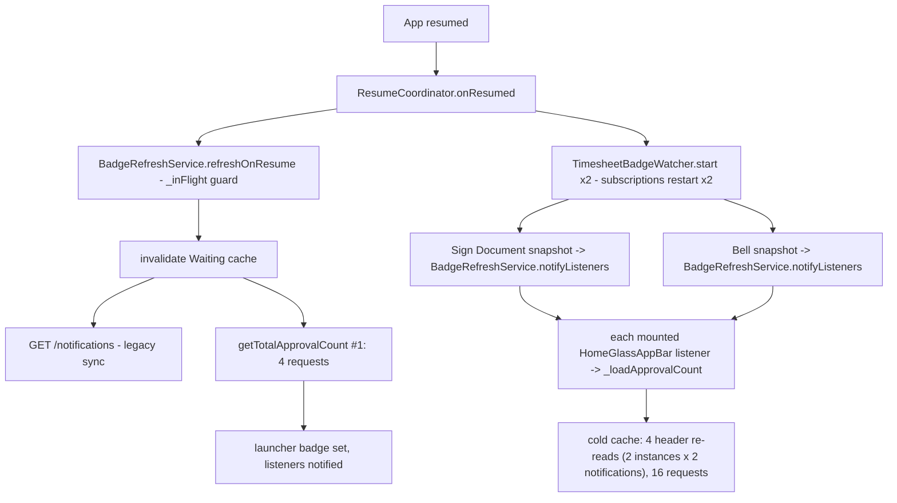
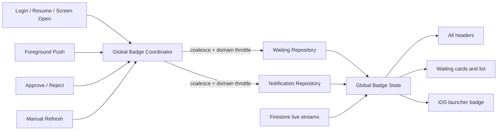

# HD-0149 - Counter and Badge Refresh Technical Report

**Ticket type:** R&D investigation (no defect fix, no behavior change)
**Branch:** `hd-0149-counter-refresh-audit` (baseline `origin/main` at `2bb86fb`)
**Date:** 2026-11-16 (static audit), 2026-11-17 (instrumentation, device runs, consolidation)

## 1. Executive summary

The app has no single owner for its global counters. Waiting approvals, the notification bell, chat unread and the launcher badge are separate singleton services and Firestore streams. The refresh flow works, but the investigation found measurable inefficiency and one count/list synchronization gap.

Evidence labels used throughout: **[STATIC]** code reading; **[TEST]** automated test or arithmetic probe on the workstation; **[DEVICE]** measured on a physical Android phone with the debug-only `[HD0149]` trace; **[UNVERIFIED]** not observed.

Key results:

1. **[DEVICE] One app resume issues 20 `/api/my_approvals_grouped` requests**, not 4. Five concurrent callers each run a four-category count fetch because the count has no in-flight de-duplication (section 6). Reproduced on 4 started refreshes (1 earlier session + 3 in this one).
2. **[DEVICE] Count and open list can diverge.** After a resume with the Waiting screen open, the header badge was reset while the already-loaded list cards were not reloaded (section 7). The row *values* in that run came from debug-build fixtures, so they are **not** production data evidence; the mechanism is what was observed.
3. **[DEVICE] The v2 bell poll runs every 60 s per mounted header instance** (2 instances => 2 requests/min). The 5-second legacy poll was not active for this account.
4. **[DEVICE] Every resume also calls legacy `GET /notifications` while the v2 inbox is enabled**, and restarts the Timesheet Firestore watcher twice.
5. **[TEST] The load probe is an arithmetic model, not a network test.** It models 4 Waiting requests per refresh; the device measured 20.
6. **[UNVERIFIED]** Login, foreground/background push, notification tap, approve/reject and Notification Center open (section 15).

## 2. Scope, method and evidence

- Scope: Flutter app, Odoo API and Firebase paths. Counters are user-visible numeric badges, queue totals, unread totals or KPIs. Dates, money, timers, percentages and non-numeric chips are excluded.
- Method: static trace of each counter to its source; debug-only instrumentation (`lib/core/diagnostics/counter_refresh_trace.dart`) emitting one JSON line per trigger/state/I-O start/end with sequence, elapsed time, source, status and duration; live runs on the device; offline probe and tests.
- Device: Samsung SM-A366B, Android 17 (API 37), package `ae.elrace.mobile` v1.0.38+106, **debug build** with the trace compiled in. The signed-in session was preserved throughout (no reinstall, no data clearing; only `force-stop`, HOME/relaunch and read-only taps).
- The trace measures from inside the app (start/end of each wrapped call). It is not an HTTP-level capture; durations include client-side time.
- Raw evidence (`docs/hd0149_evidence/`):

| File | Content |
|---|---|
| `hd0149_trace_session1.jsonl` | Earlier session on the same build: one resume, then 34 idle bell polls |
| `hd0149_trace_resume_cycles.jsonl` | 4 resumes (1 normal, 3 in a rapid burst) |
| `hd0149_trace_waiting_open.jsonl` | Opening the Waiting screen |
| `hd0149_trace_resume_on_waiting.jsonl` | Resume while Waiting screen is open |
| `hd0149_trace_cold_start.jsonl` | `force-stop` then relaunch (session kept) |
| `load_probe_simulated.json` | Output of the arithmetic probe (simulated) |
| `screenshot_waiting_open_debug_fixtures.png`, `screenshot_waiting_after_resume_badge_cleared.png` | Waiting screen before/after the resume (debug fixtures; status bar and profile avatar redacted, counter and card values untouched) |

The `.jsonl` files are minimal extracts: only the `[HD0149]` JSON trace lines from logcat, one event per line. Unrelated device log lines were removed because the raw captures contained session credentials and user identifiers; the unredacted originals are kept locally outside the repository and are not part of the deliverable. The extracts reproduce every count and timing in this report.

Tools (both diagnostic only; neither touches app data): `dart run tool/hd0149_summarize_logcat.dart <trace.jsonl|logcat.txt> [--timeline]` is an evidence-analysis tool that parses trace lines and prints event counts and I/O timing statistics; `dart run tool/hd0149_refresh_load_probe.dart` is a **simulation** with no network I/O (section 9).

## 3. Counter inventory

### 3.1 Global actionable counters [STATIC, behavior confirmed on device where noted]

| Counter | Screen / widget | Owner | Source | Refresh triggers | Evidence |
|---|---|---|---|---|---|
| Waiting total | Home headers and Waiting entry | `ApprovalCountService` | Four calls to `POST /api/my_approvals_grouped` (HR, RFQ, Invoice, Petty Cash) plus live Firestore Sign Document pending count | Header mount; authenticated resume; home route return (30 s throttle); foreground approval push (same throttle); after approve/reject; Sign Document snapshot; any `BadgeRefreshService` notification while the cache is empty | `approval_count_service.dart`; `badge_refresh_service.dart`; `timesheet_badge_watcher.dart`; `firebase_service.dart` |
| Waiting category totals | Waiting sheet cards | `ApprovalsScreen` `_countCache` | Lengths of per-category lists; Sign Document via its repository stream | Screen `initState`; category first open; pull-to-refresh; after approve/reject; retry | `Approval.dart` |
| Notification bell - legacy | Home headers | `NotificationStorageService` | Server `/notifications` unread minus stored baseline, protected by local FCM count | Header mount; 5 s poll; resume; foreground non-chat push; home return; local save/read/delete/clear; Notification Center open resets it | `notification_storage_service.dart`; `home_glass_app_bar.dart` |
| Notification bell - v2 | Home headers, Notification Center | `NotificationInboxRepository` + Firestore app-notification unread | `/v2/notifications/unread_count` + `users/{uid}/app_notifications where read=false` | Header mount; 60 s poll per header instance; resume; `inbox.sync`/foreground push; live snapshots; mark-all-read | `notification_inbox_repository.dart`; `timesheet_badge_watcher.dart` |
| Chat total unread | Home chat icon, bottom nav, comms bar | `ChatUnreadBadgeService.count` | Firestore `userChats` stream, then message queries after `last_read_at` per unmuted chat (cap 100) | `ensureListening` from displaying widgets; live updates; stops on logout. Not driven by `ResumeCoordinator` | `chat_unread_badge_service.dart`; `chat_repository.dart` |
| Per-chat unread | Chat list rows | Screen subscription | Firestore chat metadata + messages after `last_read_at` | Live while mounted | `chat_repository.dart` |
| Sign Document pending | Waiting Sign Document card | `TimesheetBadgeWatcher` | Firestore pending approvals for UID | App start; every authenticated resume restarts the watcher; auth change; snapshot | `timesheet_badge_watcher.dart` |
| My Actions - signature required | My Actions section | `SignatureActionsRepository` | Firestore chat-signable docs + `signature_documents` | While section mounted; auth switch; live | `my_actions_section.dart` |
| App icon badge | OS launcher | `AppIconBadgeService` | Local notification count + Firestore unread | Any local persist; resume refresh; watcher snapshots; read/clear | `app_icon_badge_service.dart`; iOS `AppDelegate.swift`; Android `MainActivity.kt` (no-op) |

Device: Waiting total, bell (v2 and legacy sync), Sign Document snapshot, chat `ensure_listening` and launcher `set_count` were all observed firing.

### 3.2 Home tile counters [STATIC]

Odoo-backed tiles use `HomeWidgetApiClient` (`POST /api/widgets/{path}/data`), de-duplicated per path and cached five minutes per session. They refresh on first home load/provider build and home pull-to-refresh, not on resume.

| Tile / values | Provider | Source |
|---|---|---|
| Attendance present/working days | `homeAttendanceWidgetProvider` | `/api/widgets/attendance/data` |
| HRMS employees/pending | `homeHrmsWidgetProvider` | `/api/widgets/hrms/data` |
| Timesheet workers/records/projects | `homeTimesheetWidgetProvider` | `/api/widgets/timesheet/data` |
| My Projects total/more/due | `homeMyProjectsWidgetProvider` | `/api/widgets/my_projects/data` |
| Site Management active sites | `homeSiteManagementWidgetProvider` | `/api/widgets/site_management/data` |
| My Reports | `homeMyReportsWidgetProvider` | `/api/widgets/my_reports/data` |
| LPO total | `homeLpoWidgetProvider` | `/api/widgets/lpo/data` |
| Petty Cash pending | `homePettyCashWidgetProvider` | `/api/widgets/petty_cash/data` |
| My Documents / Media / Shared Documents | respective providers | `/api/widgets/{my_documents,media,shared_documents}/data` |
| Tasks Open/Doing/Done | `TodoFirebaseProvider` | Firestore stream |
| Notes total | `NotesBloc` | Firestore watch |
| Clients / Vendors | widget cache + revision notifier | `/api/widgets/{clients,vendors}/data` |

Pull-to-refresh forces visible widget endpoints and invalidates providers (`main_home_content_widget.dart`, `home_widget_refresh_service.dart`). Returning to Home refreshes only Waiting and bell.

### 3.3 Screen-local KPI counters [STATIC]

Loaded when the screen/provider opens; updated by pull-to-refresh, invalidation or action callbacks; not refreshed on resume.

| Module counters | Owner | Source |
|---|---|---|
| HR personal requests (Pending/Approved/Rejected/Draft) | `hrRequestListProvider` | derived from `/api/hr/my_requests` |
| HR manager Total/Pending/Approved | `hrTeamKpisProvider` | `/api/hr/team_requests/kpis` (fallback: list) |
| HR circular badge | `hrCircularYearCountProvider` | circular API |
| Recruitment dashboard/requisition KPIs | dashboard providers | `/api/recruitment/dashboard`, `/kpis`, `/requisitions` |
| Purchase hub/MR/RFQ/LPO/invoice totals | purchase providers | `PurchaseRepository` |
| Labor Transfer entry / To Approve | `laborTransferCountsProvider` | `/api/labor_transfer/*` counts |
| Pending Payslips | `payslipPendingCountProvider` | **Mock in-memory data, not backend** |
| Attendance Reports KPI strip | attendance dashboard provider | attendance dashboard API |
| Timesheet/project dashboard totals | timesheet providers | Odoo/Firebase repositories |

## 4. Refresh triggers and flows

### 4.1 Startup and login [STATIC; cold start [DEVICE]]

- Cold start with a stored session: non-critical startup starts `TimesheetBadgeWatcher` and attendance sync (`main.dart`). `PostLoginSetup.applyAfterLogin()` clears home caches, fetches home data, syncs attendance and starts the watcher; it does not itself fetch Waiting or bell totals.
- Waiting and bell make their first fetch when the authenticated home header mounts. Chat starts when a badge widget calls `ensureListening()`.
- [DEVICE] Cold start: 2 header instances mounted, 2 count fetches (8 Waiting requests), 2 v2 `unread_count` calls, 0 legacy `/notifications`, 3 chat `ensure_listening` calls, one `start_initial` + `subscriptions_restart` x2.
- [UNVERIFIED] Login path (`login_success` trace point exists, not exercised).

### 4.2 Resume [STATIC + DEVICE]

Entry point `_MyAppState.didChangeAppLifecycleState` (`main.dart`) then `ResumeCoordinator.onResumed()`: immersive/portrait restore, VPN guard, security timeout check, `ForceLogoutGuard`, then **`BadgeRefreshService.refreshOnResume()`**, FCM token sync, Firebase session refresh, **`TimesheetBadgeWatcher.start()`** (restarts subscriptions when already started), feature-flag refresh, and after 1.5 s the Tier-2 listeners and attendance sync (15 s cooldown). Screen-level `WidgetsBindingObserver`s run around this with no guaranteed relative order.

### 4.3 Push and notification tap [STATIC; no live runs]

- Foreground general push: save/show and sync bell; v2 refreshes its server badge.
- Foreground approval push: invalidate cache and call `refreshWaitingAndBellThrottled(reason:'approval_push')`, sharing the 30 s throttle with home-return, even if the category is muted.
- Background legacy general push: stored in the background isolate and local badge incremented. Background approval/chat/inbox-sync/v2 push is skipped by the storage path.
- Tap: stores/routes the event; global refresh happens on resume.

### 4.4 Approve / reject [STATIC; not exercised]

`_refreshApprovalsAfterAction()` removes the item optimistically, invalidates the shared count, force-reloads all four lists and republishes the aggregate. This is the strongest convergence path.

### 4.5 Observed resume flow [DEVICE]



## 5. Measured runtime traces [DEVICE]

All durations are app-side milliseconds. One device, one network, a few minutes of sampling: **indicative only; no percentile claims**.

### 5.1 I/O per trigger

| Trigger | Waiting `my_approvals_grouped` | Bell | Other | Source file |
|---|---|---|---|---|
| Resume (4 started refreshes: 1 earlier session, 3 this session) | 20 per refresh (20, then 60 over 3) | 1 legacy `GET /notifications` per refresh | watcher restart x2 per resume | session1, resume_cycles |
| `resume_cycles` file: 4 resumes (1 normal + 3 in 1 s gaps) | 3 refreshes started, 1 coalesced by `_inFlight`; 60 requests total (20 per started refresh) | 3 legacy | `global_badges.coalesced_in_flight` x1 | resume_cycles |
| Resume with Waiting screen open | 28 (7 count fetches) | 1 legacy | no `waiting_list` reload triggered | resume_on_waiting |
| Cold start | 8 (2 count fetches) | 2 v2 `unread_count`, 0 legacy | `start_initial` + restart x2 | cold_start |
| Open Waiting screen | 4 list requests (count cache hit, 0 extra count requests) | 1 v2 (header mount) | - | waiting_open |
| Idle home | 0 | 34 v2 `unread_count` over about 960 s (2 per 60 s) | 37 launcher `set_count` calls in the same window | session1 |

Firestore: only listener starts/restarts and snapshot deliveries are instrumented (`timesheet_badges`, `waiting_sign_document`, `notification_bell_firestore`, `chat_unread`). **Per-document read counts were not measured.**

### 5.2 Response times (ms)

| Operation | n | min | median | avg | max |
|---|---|---|---|---|---|
| Waiting count request, resume, session 1 | 20 | 628 | 864 | 1101 | 1915 |
| Waiting count request, resume cycles | 60 | 487 | 858 | 1056 | 2147 |
| Waiting count request, resume with Waiting open | 28 | 474 | 676 | 843 | 1640 |
| Waiting count request, cold start | 8 | 2100 | 3517 | 3258 | 4793 |
| `GET /v2/notifications/unread_count` (poll) | 34 | 430 | 578 | 614 | 1591 |
| `GET /notifications` (resume sync), cycles | 3 | 674 | 726 | 759 | 876 |
| `GET /notifications`, session 1 / waiting-open resume | 1 / 1 | - | 773 / 439 | - | - |
| Waiting list requests on screen open (hr/petty/rfq/invoice) | 4 | 843 | - | - | 1806 |

Resume to `refresh_finished`: 2717 ms (session 1) and 2220 ms (cycle A). Invoice is consistently the slowest category (1.7-1.9 s vs 0.5-1.0 s).

## 6. Why one resume produces 20 Waiting requests

**Mechanism [STATIC, confirmed by trace]:** `ApprovalCountService.getTotalApprovalCount()` returns the cached value if present, otherwise it fires four parallel `my_approvals_grouped` requests (HR, RFQ, Invoice, Petty Cash). Nothing tracks an in-flight fetch, so every caller that arrives while the cache is empty issues its own four requests.

**Callers on a resume** (trigger name in trace, all `cache_hit:false`):

| # | Initiator | Trace evidence | Requests |
|---|---|---|---|
| 1 | `BadgeRefreshService.refreshOnResume()` (invalidates cache, then fetches) | `waiting.authenticated_resume` | 4 |
| 2-3 | `HomeGlassAppBar` instance A: reacts to two `BadgeRefreshService.notifyListeners()` calls | 2x `waiting.header_read` | 8 |
| 4-5 | `HomeGlassAppBar` instance B: same listener | 2x `waiting.header_read` | 8 |

The two notifications come from `TimesheetBadgeWatcher.start()`, which `ResumeCoordinator` calls on every resume. It restarts its Firestore subscriptions and each restart delivers a snapshot: the Sign Document snapshot (`waiting_sign_document.firestore_snapshot`, count 0) and the bell snapshot (`notification_bell_firestore.firestore_snapshot`). Both call `BadgeRefreshService.notifyListeners()`, and every header listener re-reads the count (`home_glass_app_bar.dart` initState listener). The cache was invalidated moments earlier by `refreshOnResume()` and is still empty, so each re-read starts a new four-request fetch. 5 fetches x 4 = **20**.

**Overlap:** the header reads start about 1.1 s into the resume (seq 143-160) while the first fetch is still in flight (it completes about 2.7 s in). All 20 requests overlap within roughly 2 s. The `_inFlight` guard in `BadgeRefreshService` covers only the refresh itself, not these header reads.

**Cross-checks that the model holds [DEVICE]:**
- Cold start: 2 header initState reads x 4 = 8 (observed 8).
- Resume with the Waiting screen open: that screen mounts its own header (`notification_bell.header_mount` appears in its log), i.e. a third instance (inferred). 1 + 3 x 2 = 7 fetches x 4 = 28 (observed 28).
- 2 instances also match the 2 bell timers (2 polls per minute).

**Confirmed by instrumentation?** The request counts are exact: each request passes through `CounterRefreshTrace.io` (`call` numbers 29-48 in session 1 are contiguous). The attribution of callers is by trigger label and timing, plus the code path above; it was not verified by a debugger. "Instance A/B" is inferred from the count of timers and header reads.

**Original assumptions that proved incorrect or incomplete:**

| Original statement (static audit) | Corrected by measurement |
|---|---|
| A Waiting refresh downloads four lists to count them (4 requests) | True per fetch, but a resume runs **five** fetches (20 requests) |
| Resume runs one refresh that warms the cache so listeners are "cheap" (comment in `badge_refresh_service.dart`) | Listeners fire while the cache is still empty, so they refetch |
| Legacy header polls every 5 s | Not active for this v2-enabled account; v2 polls every 60 s **per instance** |
| Watcher restart is a minor cost | It is the trigger of 4 of the 5 fetches (via snapshots and `notifyListeners`) |
| The probe's 4 Waiting requests per refresh | Understated 5x (section 9) |

## 7. Waiting records versus Waiting count

Static behavior: the count path and the screen path use the same endpoint and category rules but separate requests and caches. On external badge notification the screen reloads only when `ApprovalCountService.cachedCount == null` (`Approval.dart`); resume/push normally refill that cache first, so a mounted list can remain stale while the number is current.

**Device observation [DEVICE, debug fixtures - not production data]:**

- The server returned **0 pending items in all four categories** for this account (`odoo_count:0` on every count refresh; list loads logged `records:0`).
- The debug build injects local fixture rows in `kDebugMode` (`_ensureDebugWaitingHrRequests`, `_ensureDebugWaitingInvoice` in `Approval.dart`: 24 HR rows and 1 invoice). The screen then wrote 25 into the shared count cache, so the header badge showed 25.
- After a resume with this screen open, the resume path recomputed the count from the server (0) and the header badge disappeared, while the cards still showed HR 24 / Invoice 1; no `waiting_list` reload was triggered (`hd0149_trace_resume_on_waiting.jsonl`, two screenshots).
- **What this shows:** a resume updates the header count without reloading an already-open list. **What it does not show:** that production data would drift by 25; the 25 is a debug artifact.

## 8. Notification counter semantics [STATIC]

**Legacy inbox:** the bell is "new server unread since the last Notification Center open": `max(serverUnread - storedBaseline, localPendingCount)`. The `max` keeps a local FCM bump until the server catches up. Opening Notification Center calls `acknowledgeBadge()`, stores the baseline, zeroes the bell and marks notifications read. **V2:** reads `/v2/notifications/unread_count`; Timesheet result notifications live in Firestore and are added by `TimesheetBadgeWatcher`; sources are combined in several places without one state object.

**Launcher:** iOS applies the number via `UNUserNotificationCenter`/`UIApplication`. Android's `setBadge` channel returns success without applying a number, so no Android numeric launcher badge is created.

[DEVICE] On this account the bell, server unread (2, baseline null) and launcher count (2) agreed on every resume.

## 9. Load probe [TEST - simulated, not live network]

`dart run tool/hd0149_refresh_load_probe.dart` (output in `load_probe_simulated.json`). It is a standalone arithmetic model of the current gates: it hard-codes assumed durations (1200 ms global refresh, 900 ms list reload), performs no network I/O and calls no app code.

| Input | Modeled result |
|---|---|
| 20 resume events, 250 ms apart | 4 refreshes started, 16 coalesced |
| 20 approval pushes, 500 ms apart | 19 throttled by the 30 s gate |
| 10 approve/reject events | 40 Waiting list requests (4 each) |
| Totals | 56 Waiting requests, 4 notification requests |

Compared with the device: the model assumes 4 Waiting requests per refresh (measured 20) and a 1.2 s refresh (measured 2.2-2.7 s). Resume coalescing was seen live once (consistent with the model). The approval-push throttle and the approve/reject counts were **not** observed live. The probe should not be quoted as a performance measurement.

## 10. Before/after validation for approve/reject

[UNVERIFIED]. No real record could be approved or rejected: the server returns 0 pending items for this account, and the only visible rows are local debug fixtures whose actions would call production APIs with fake ids. The after-action path is instrumented (`waiting_list.approve_reject_success` with `records_before`/`counter_before`, and `action_reconciled` with `records_after`/`counter_after`) and unit-covered only for trace formatting. It is described in section 4.4 [STATIC].

## 11. Instrumentation and production-safety review

[STATIC unless noted]

- **Debug-only:** `CounterRefreshTrace` emits only when `kDebugMode || forceEnabled` (`forceEnabled` is `@visibleForTesting`). In release, `io()` returns `call()` directly. Limitation: the small `fields` maps at call sites are still allocated in release (negligible).
- **No behavior change:** `git diff -w` shows only trace calls, optional `trigger` parameters (defaults preserve existing callers), and call-wrapping changes where an existing call is passed through `CounterRefreshTrace.io` (`syncBadgeFromServer`, `getNotifications`, `_fetchCategoryData`, `refreshBadge`). The largest is: the four-category count request body in `_fetchCategoryCount` is wrapped in a closure passed to `CounterRefreshTrace.io` (same code, same try/catch, same return values). No refresh logic, throttle, debounce, cache policy or API contract changed. The `.timeout(...)` wrappers in `refreshOnResume` are unchanged in effect.
- **Scope:** no IT Request files are modified.
- **Sensitive data:** logs contain counters, category names, durations, trigger names and error *type names*. No tokens, credentials, personal data or error messages.
- **Instrumentation accuracy limits:**
  - `ApprovalCountService._fetchCategoryCount` swallows all errors and returns 0, so its trace shows `status:"success"` even on HTTP failure or timeout. **Zero recorded count errors does not prove 200 responses.** The swallow-to-0 is also a production behavior risk (a failed count shows as 0).
  - The Waiting list request (`_fetchCategoryData`) and `GET /notifications` throw on non-2xx, so failures there are traced as `error`.
  - The outer `.timeout(onTimeout: () => 0)` in `refreshOnResume` is not traced; a timed-out wrapper does not stop the traced call.
  - Firestore is traced at listener/snapshot level only.
  - The two `authenticated_resume` trigger lines per resume are two trace points of one execution (one `syncBadgeFromServer` per resume), not duplicate work.

## 12. Confirmed gaps and risks

| # | Finding | Evidence |
|---|---|---|
| 1 | Waiting count fetch has no in-flight de-duplication; 5 fetches (20 requests) per resume | DEVICE |
| 2 | Resume updates the count but not an open Waiting list | DEVICE (debug fixtures) + STATIC |
| 3 | Bell polling is per header instance (2/min, v2) | DEVICE |
| 4 | Legacy `/notifications` call on every resume while v2 is on | DEVICE |
| 5 | Double Timesheet watcher restart per resume, which also feeds finding 1 | DEVICE |
| 6 | Count fetch returns 0 on any error (masked failure) | STATIC |
| 7 | Shared 30 s approval throttle can swallow a real second push or home-return refresh | STATIC |
| 8 | Chat unread: per-chat message queries on each aggregate emission, 100-message cap; `ensureListening` re-subscribes | STATIC |
| 9 | Mixed notification sources (legacy baseline, v2, local FCM cache, Firestore) can disagree briefly; Project greeting header omits Firestore unread | STATIC |
| 10 | Android launcher numeric badge is a no-op | STATIC |
| 11 | Home tiles do not refresh on resume (5-minute cache) | STATIC |
| 12 | Legacy widget providers coexist with live Firestore sources for Tasks/Notes | STATIC |
| 13 | Pending Payslips is mock data | STATIC |

## 13. Proposed improvements (not implemented)

**Priority order:**

1. **Single in-flight future** in `getTotalApprovalCount()` so concurrent readers share one four-request fetch. Measured target: 20 to 4 requests per resume.
2. **Waiting snapshot as single source of truth:** publish count, category counts and records from one response; resume/push also refresh or mark stale an open list.
3. **Count endpoint** (server-side) or reuse of list responses already loaded, instead of downloading four lists to count them.
4. **One bell poll per app**, not per header instance; event-driven with a conservative stale-time fallback; skip legacy `/notifications` when v2 is enabled.
5. **Idempotent `TimesheetBadgeWatcher.start()`** for the same UID, and avoid notifying listeners while the Waiting cache is empty.
6. **Trailing debounce / coalescing** instead of dropping approval pushes inside the 30 s throttle.
7. **Surface count failures** instead of returning 0.
8. Decide and document Android launcher badge expectations; add tests for resume coalescing, two pushes in one window, approve/reject reconciliation, inbox-open reset and count/list equality.

**Target model.** Keep existing repositories and UI. Add one small state owner for the two server-backed domains (Waiting and Notification inbox); chat and Firestore counters stay live streams.

```text
GlobalBadgeState
  waiting: { total, categoryCounts, lastSuccessAt, revision, loading }
  notifications: { serverUnread, firestoreUnread, displayed, lastSuccessAt, loading }
```

| Event | Foreground action | Background |
|---|---|---|
| Login / authenticated start | Force one Waiting + notification refresh | none |
| Resume | Refresh if last success is older than 15-30 s; coalesce in-flight | none |
| Waiting screen open | Use snapshot; refresh if stale | none |
| Pull-to-refresh | Force lists and counters together | none |
| Approve / reject success | Optimistic remove/decrement, then one forced reconciliation | none |
| Foreground approval push | Debounce 500-1000 ms, then force reconciliation | none |
| Foreground inbox push | Optimistic increment, debounce one server reconciliation | none |
| Background push | OS/server persist; no arbitrary Flutter network work | resume/tap reconciles |
| Chat / Firestore change | Live stream updates only its slice | Firestore/FCM owns delivery |

Use one in-flight future **per domain** instead of one global throttle: throttle passive events (resume, screen open) but never discard semantic events (approve/reject, new approval push); debounce them into a trailing refresh.



## 14. Future scaling considerations

- **Request multiplication:** Waiting requests scale as (readers of the count) x 4 per refresh trigger. A new header or screen reading the count multiplies server load per resume (the Waiting screen alone added a third reader in the measured run).
- **Background rate:** the v2 bell poll is about 2 requests/min/device regardless of activity; the legacy 5 s mode would be roughly 12x per instance. Fleet-level load grows linearly with active devices.
- **Payload growth:** four full lists are downloaded only to be counted, so bandwidth and latency grow with queue size (invoice is already about 2x slower than other categories). A count endpoint with a revision marker lets screens detect staleness cheaply.
- **Chat:** unread queries run per unmuted chat (cap 100), so Firestore reads grow with chat count and can undercount past the cap.
- **Firestore subscriptions:** repeated watcher restarts re-deliver snapshots, which cascades into API calls; per-document read cost was not measured and should be before sizing.
- **Platform divergence:** iOS has an app-controlled numeric badge; Android relies on OEM notification dots.
- **Release behavior** (no debug fixtures, possibly different feature flags and account data) was not measured; re-run the traces on a release-like build with representative pending data before drawing capacity conclusions.

## 15. Remaining unverified scenarios

| Scenario | Reason |
|---|---|
| Login | Requires logout, which would discard the session. `login_success` trace point not exercised. |
| Foreground / background push, notification tap | No safe way to send a real FCM message. Trace points exist (`push.foreground_received`, `background_received`, `background_tap`, `terminated_tap`, `waiting.approval_push`). The 30 s throttle was not observed live. |
| Approve / reject and before/after counter+list | No real pending records; production records must not be modified. |
| Notification Center open / acknowledge | Would mutate the account's read state and baseline. |
| Per-document Firestore reads; chat unread N+1 | Only listener-level tracing; no chat activity generated. |
| Android launcher numeric badge | Channel is a no-op [STATIC]. |
| Release build and production-sized data | Device build is debug with fixtures. |

## 16. Validation summary

| Check | Result |
|---|---|
| `flutter test` `counter_refresh_trace_test`, `badge_refresh_throttle_test`, `approval_count_service_sum_test` | 13/13 passed (re-run after the formatting cleanup) |
| Codex-reported earlier run | 23/23 (not re-run in full) |
| Load probe | Reproduced identically [simulated] |
| `dart analyze`, each modified file individually | No errors. `approval_count_service`, `timesheet_badge_watcher`, `post_login_setup`, `firebase_service`, `home_glass_app_bar`: no issues. `notification_storage_service`: 1 info (`avoid_print`, pre-existing line 396). `resume_coordinator`: 1 info (unnecessary import, pre-existing). `Approval.dart` and `main.dart`: pre-existing warnings (unused import / unused element) and infos. |
| Analyzer batch run | The analysis server crashed once when given all files together; each file passes individually. |
| New diagnostics/test/tool files | 2 info lints in `tool/` scripts (`avoid_print`, `forEach`) |
| `git diff --check` | clean |

## 17. Appendix: files

- Instrumentation: `lib/core/diagnostics/counter_refresh_trace.dart` plus trace calls in 12 existing files (`approval_count_service`, `badge_refresh_service`, `notification_storage_service`, `resume_coordinator`, `timesheet_badge_watcher`, `app_icon_badge_service`, `chat_unread_badge_service`, `post_login_setup`, `firebase_service`, `main`, `Approval.dart`, `home_glass_app_bar`).
- Tests/tools: `test/core/counter_refresh_trace_test.dart`, `tool/hd0149_refresh_load_probe.dart` (simulated), `tool/hd0149_summarize_logcat.dart`.
- Progress checkpoint: `docs/HD-0149_HANDOVER_PROGRESS.md`.
